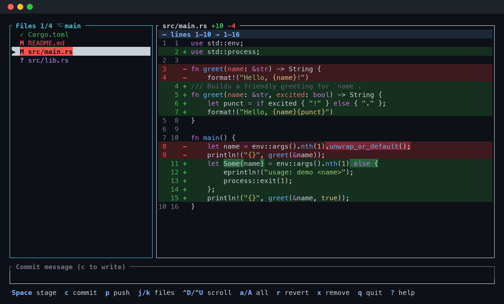

# gitrat

CLI project to see git changes and commit. I created this project to personal use, feel free to contribute.



## Installing

#### Cargo 🦀
Installing from [crates.io](https://crates.io/) (requires Rust/Cargo):

```shell
cargo install gitrat
```

#### Homebrew 🍻
You can install with [Homebrew](https://brew.sh/):

```shell
brew tap heroesofcode/taps
brew install heroesofcode/taps/gitrat
```

## Usage

```shell
gitrat            # open the repository containing the current directory
gitrat path/to/repo
gitrat --no-mouse # keep the terminal's native text selection
gitrat --theme light   # force light/dark colours (default: auto)
```

The diff view shows old/new line numbers, syntax highlighting (bat's language
set, including Rust, Swift, Kotlin, TypeScript, TOML…), tinted added/removed
lines and word-level highlighting of exactly what changed inside a line.

gitrat works from any subdirectory of a repository, refreshes automatically when
files change, and runs `git push` in the background so the UI never freezes.

### Keys

| Key | Action |
| --- | --- |
| `j`/`k`, `↑`/`↓`, `Tab` | next / previous file (mouse click also selects) |
| `Space` / `Enter` | stage or unstage the selected file |
| `a` / `A` | stage all / unstage all |
| `r` | revert the selected file (asks for confirmation) |
| `x` | remove the selected file (asks for confirmation) |
| `c` | write a commit message (`Enter` commits, `Esc` cancels) |
| `p` | push (sets the upstream automatically) |
| `Ctrl-D` / `Ctrl-U` | scroll diff half a page |
| `Ctrl-F` / `Ctrl-B` | scroll diff a full page |
| `J` / `K`, `Shift-↓` / `Shift-↑` | scroll diff one line |
| `g` / `G` | top / bottom of the diff |
| `h` / `l`, `←` / `→` | scroll diff horizontally |
| `R`, `F5`, `Ctrl-L` | refresh |
| `?` | help |
| `q`, `Ctrl-C` | quit |

In the commit bar: `Ctrl-W` (or `Option-Delete` with "Use Option as Meta key") deletes a word, `Ctrl-U` clears, and
pasting multi-line text is safe (newlines become spaces).

### macOS Terminal.app

Light or dark colours are picked from `COLORFGBG` or, on macOS, the system
appearance (which Terminal.app's default profile follows); override with
`--theme light|dark`. 24-bit colour is used when the terminal advertises it
(`COLORTERM=truecolor`, iTerm2, Ghostty, WezTerm…), otherwise a 256-colour palette. Terminal.app keeps `PageUp`,
`PageDown`, `Home` and `End` for its own scrollback, so every diff action also has a
letter binding. To select text with the mouse while gitrat is running, hold `Fn`
(or start with `--no-mouse`). `git push` never prompts inside the TUI: use the
macOS keychain credential helper or an SSH agent.
